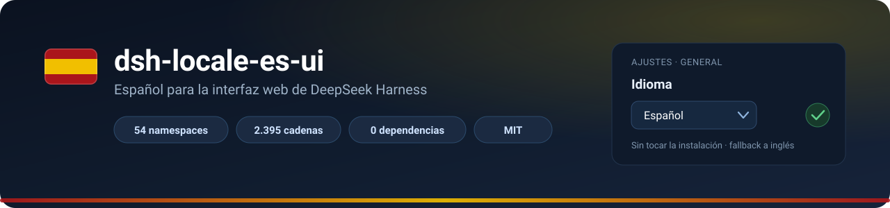

<a id="espanol"></a>

<div align="center">



# dsh-locale-es-ui

**La interfaz web de DeepSeek Harness, en español.**<br>
Instalas, reinicias y eliges *Español*. No toca tu instalación y todo lo que no esté
traducido sigue saliendo en inglés.

[](https://www.npmjs.com/package/dsh-locale-es-ui)
[](https://www.npmjs.com/package/dsh-locale-es-ui)
[](https://github.com/urtziDV/dsh-locale-es-ui/actions/workflows/ci.yml)
[](LICENSE)
[](package.json)
[](package.json)
[](https://github.com/deepseek-ai/deepseek-harness)

🇪🇸 **Español** · [🇬🇧 English](#english)

</div>

---

## ⚡ Instalación en 30 segundos

| Vía | Cómo |
|---|---|
| 🖱️ **Interfaz** | Barra lateral → **Plugins** → **Add plugin** → `dsh-locale-es-ui` |
| ⌨️ **CLI** | `dsh plugin --profile web add dsh-locale-es-ui` |
| 📦 **Sin registro** | Descarga el `.tgz` de la [release](https://github.com/urtziDV/dsh-locale-es-ui/releases) y añádelo por ruta |

Luego **reinicia DSH** y elige **Español** en **Ajustes → General → Idioma**.
Si tu navegador ya está en español, puede activarse solo.

> ¿No te convence? `dsh plugin --profile web remove dsh-locale-es-ui` y vuelves al inglés.

## ✨ Qué hace

- 🌍 **Añade Español al selector de idioma** de DSH, junto a English y 中文.
- 🧩 **Solo usa el API público** de localización (`ctx.locale.addLanguage` /
  `ctx.locale.register`): no parchea `node_modules` ni el código de DSH.
- 🪂 **Fallback por clave**: lo que no esté traducido sale en inglés, así que una
  actualización de DSH nunca deja huecos ni rompe la interfaz.
- 🪶 **Cero dependencias** y 110 kB: es un plugin de cliente, en dos mitades.
- ♻️ **Desinstalable** en un comando; tu preferencia de idioma se conserva.
- 🛡️ Los **identificadores técnicos** (nombres de herramientas, tokens de comando, rutas,
  nombres de producto) se quedan en inglés a propósito, igual que en el sistema de
  localización de DSH.

## 📊 Cobertura

| | |
|---:|---|
| Namespaces | **54** |
| Cadenas | **2.395** |
| Traducidas | **2.258** |
| Idénticas al inglés (formatos y términos técnicos) | 137 |
| Build de referencia | **DSH 0.2.0-rc.2** |

Los namespaces más grandes, para que te hagas una idea de dónde está el trabajo:

```text
conversation     367  ████████████████████████████████████████
trajectory       192  █████████████████████
pluginManager    189  ████████████████████
chat             186  ████████████████████
settings.models  113  ████████████
workspace        112  ████████████
```

Y aparte, los ajustes repartidos en 13 namespaces `settings.*` suman **390 cadenas** más.

### Alcance

| Cubierto | Fuera de alcance |
|---|---|
| Interfaz web: ajustes, chat, trayectoria, paneles, diálogos, atajos, plugins… | Los **menús nativos del shell de Electron** (barra de título, bandeja, diálogos del sistema): son otra capa, con su propio catálogo |
| Todo el texto producto que pasa por el registro de localización | Las respuestas del modelo y los datos que muestra (rutas, salida de herramientas) |

## 🔧 Cómo funciona

Un plugin de cliente de DSH normal. El navegador recibe un bundle que se registra a sí
mismo y, al materializarse, declara el idioma y sus diccionarios:

```text
dsh-locale-es-ui/
├── index.js            mitad host · apply() vacío: solo da la fila de Loader
├── cordis.patch.yml    capa de perfil · inserta la fila `locale-es`
├── lib/client.js       mitad navegador · GENERADA: registra `es` y los 54 diccionarios
└── data/
    ├── language.json   id, etiqueta («Español») y fallback
    ├── es.json         fuente de verdad de las traducciones
    └── en.json         corpus inglés de referencia con el que se valida la paridad
```

`dsh-client-modules` escanea la fila de Loader, sirve `lib/client.js` al navegador y allí
`ctx.locale.register(ns, 'es', …)` entra en el registro oficial de localización. Ni el
paquete ni el script tocan la instalación de DSH.

## 🛠️ Editar, ampliar, mantener

```sh
npm run build      # data/ -> lib/client.js + cordis.patch.yml
npm test           # paridad de claves, {marcadores}, comillas y el bundle
npm run verify     # ejecuta el bundle con el protocolo real del navegador
```

`npm test` comprueba que cada `{marcador}` del inglés siga apareciendo en español: es el
error más fácil de cometer al traducir, y una prueba lo caza antes que un usuario.

**Cuando DSH se actualice**, el corpus de referencia se regenera desde tu propia
instalación:

```sh
npm run extract -- "C:\...\DeepSeek Harness\resources\app.asar"
```

Eso reescribe `data/en.json`; las claves nuevas caen a inglés hasta que las traduzcas, y
`npm test` te dice exactamente cuáles faltan.

## 🤝 Contribuir

¿Una frase que suena rara, una etiqueta que no cabe, una errata? Abre un
[issue](https://github.com/urtziDV/dsh-locale-es-ui/issues) o manda un PR tocando solo
`data/es.json`.

- [CONTRIBUTING.md](CONTRIBUTING.md): cómo editar, construir y probar.
- [docs/GLOSARIO.md](docs/GLOSARIO.md): glosario y decisiones de terminología.

## 🙏 Créditos y licencia

MIT. Las cadenas de origen en inglés provienen de
[DeepSeek Harness](https://github.com/deepseek-ai/deepseek-harness) (MIT, © 2026 DeepSeek);
este paquete solo añade la traducción y el pegamento de localización.

**Proyecto no oficial**, desarrollado de forma independiente. No está revisado ni
respaldado por DeepSeek.

---

<a id="english"></a>

## 🇬🇧 English

**Spanish (es) language pack for the DeepSeek Harness web UI.** Install it, restart DSH and
pick *Español* in **Settings → General → Language**. It never touches your DSH
installation, and anything it does not translate keeps falling back to English.

| | |
|---|---|
| Install | **Plugins → Add plugin** → `dsh-locale-es-ui`, or `dsh plugin --profile web add dsh-locale-es-ui` |
| Coverage | **54 namespaces · 2,395 strings** (2,258 translated) from DSH **0.2.0-rc.2** |
| Approach | Registers through the public locale API (`ctx.locale.addLanguage` / `ctx.locale.register`); zero dependencies, 110 kB |
| Scope | The **web UI**. The Electron shell's native menus (title bar, tray, system dialogs) are a separate layer with its own catalog and are not covered here |
| License | MIT, with attribution to DeepSeek Harness (MIT, © 2026 DeepSeek) |

```sh
npm run build && npm test        # regenerate the bundle and check parity
npm run extract -- <path>/resources/app.asar   # refresh the English corpus from your build
```

Unofficial, independently maintained project — not reviewed or endorsed by DeepSeek.

<div align="center">
<sub>Hecho por <a href="https://github.com/urtziDV">urtziDV</a> · <a href="#espanol">volver arriba</a></sub>
</div>
